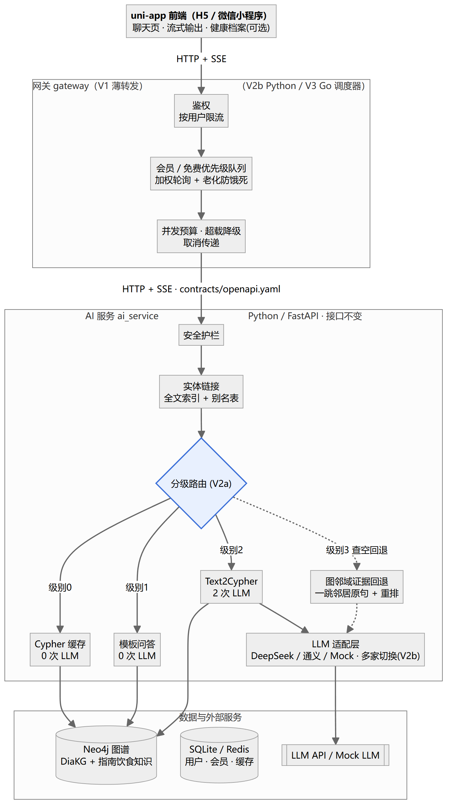

# dm-kgqa：糖尿病知识图谱智能问答系统

> 本科毕业设计：《基于 Neo4j 知识图谱与大语言模型的糖尿病智能问答系统设计与实现》

面向糖尿病患者和家属的健康问答助手。问题由大语言模型理解并转成图谱查询（Text2Cypher），**答案只来自知识图谱的查询结果，并附上依据**；查不到就如实告知，诊断、剂量类问题直接拒答。

## 当前状态

| 版本 | 内容 | 状态 |
|---|---|---|
| V1 基础版 | Text2Cypher 问答、安全护栏、H5 界面、三组对比实验 | 设计中 |
| V2a 省资源 | 分级路由、Cypher 缓存、Schema 裁剪、数据库优化 | 未开始 |
| V2b 高并发调度 | 会员/免费优先级、限流、超载降级、多家 LLM 切换、压测 | 未开始 |
| V3 Go + Python | Go 重写网关，与 Python 版对比 | 未开始 |

## 架构



前端（uni-app：H5 / 微信小程序）→ 网关（用户级调度）→ AI 服务（护栏、实体链接、分级路由、Text2Cypher）→ Neo4j / LLM API。详见 [架构设计](docs/02-design/architecture.md)。

## 目录

```
docs/          文档：产品需求、设计、ADR、测试、运维（索引见 docs/README.md）
contracts/     网关 ↔ AI 服务接口契约（openapi.yaml）
kg/            图谱 Schema 与数据导入            （V1 开发中补充）
ai_service/    AI 服务，Python / FastAPI         （V1 开发中补充）
gateway_py/    Python 网关                       （V1 开发中补充）
gateway_go/    Go 网关                           （V3）
app/           uni-app 前端                      （V1 开发中补充）
eval/  bench/  评测与压测                         （V1 / V2b）
```

## 快速开始

尚未开始编码，V1 第一个可运行版本完成后补充。配置项见 [`.env.example`](.env.example)。

## 文档

从 [docs/README.md](docs/README.md) 开始阅读：里面有研发流程、全部文档的索引与状态，以及开发约定。

## 声明

本项目仅用于学术研究和健康科普，**不提供诊断、处方或用药剂量建议**。如有健康问题，请咨询医生。

## 数据来源

图谱主体数据来自 DiaKG（Chang et al., *DiaKG: an Annotated Diabetes Dataset for Medical Knowledge Graph Construction*, 2021, [arXiv:2105.15033](https://arxiv.org/abs/2105.15033)），通过[阿里云天池](https://tianchi.aliyun.com/dataset/dataDetail?dataId=88836)获取，许可为 CC BY-NC。本项目对其做了实体归一化、关系细分，并补充了指南中的饮食知识。原始数据不包含在本仓库中。详见 [ADR-0007](docs/02-design/adr/0007-diakg-as-kg-source.md)。
