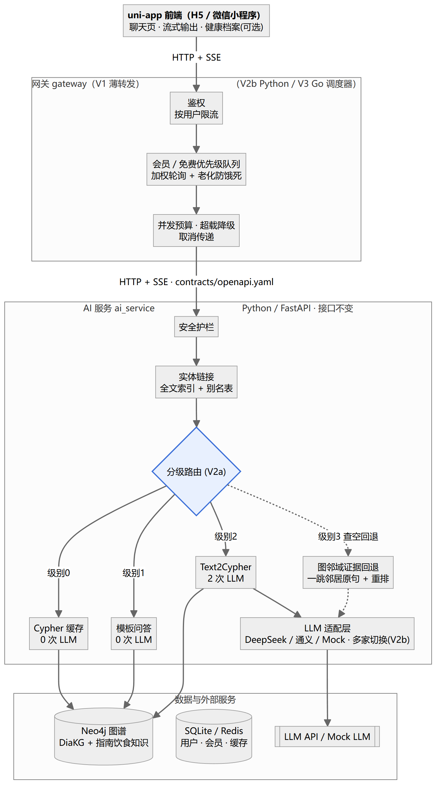
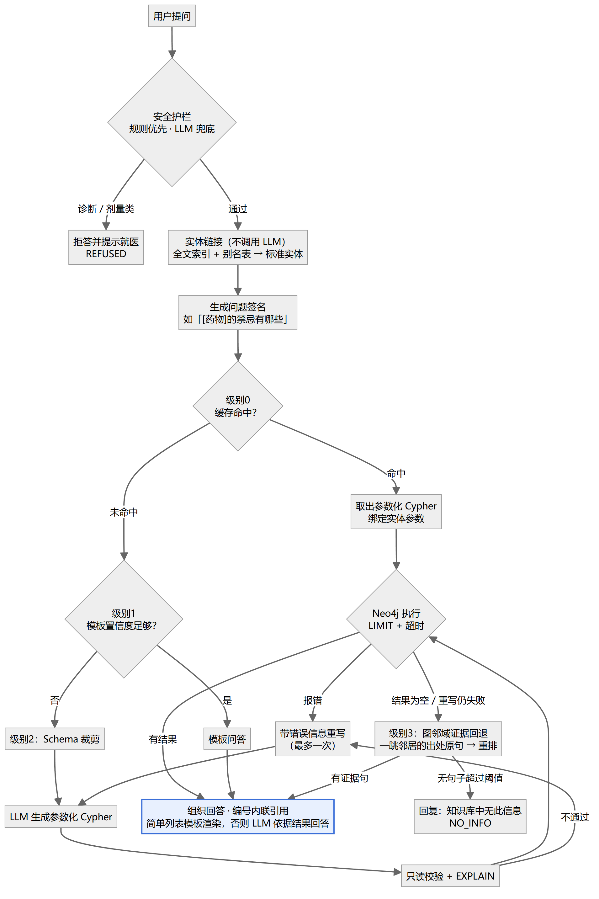
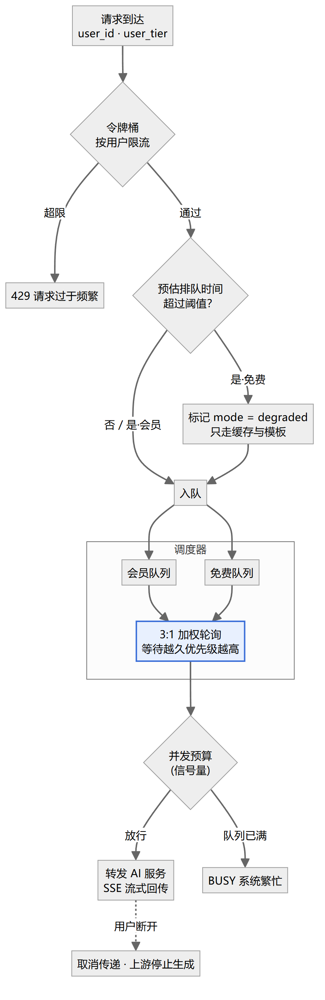
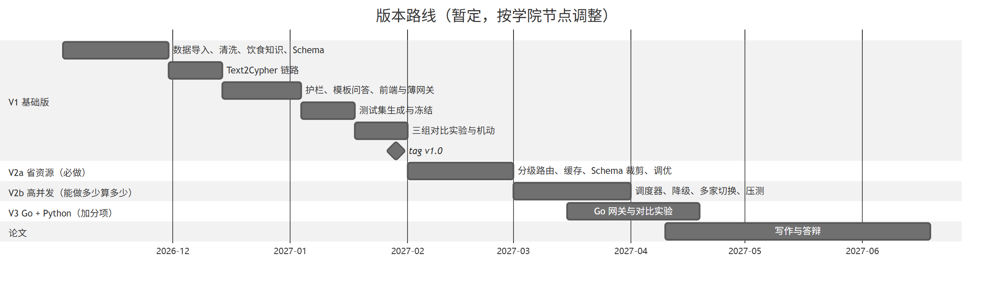

# 糖尿病知识图谱智能问答系统：架构与版本规划

> 课题：《基于 Neo4j 知识图谱与大语言模型的糖尿病智能问答系统设计与实现》
> 版本路线：V1 基础版 → V2a 省资源 → V2b 高并发调度 → V3 Go + Python
> 编写日期：2026-10-29（初稿，开工后按实际情况修订）

---

## 一、架构规划（四个版本共用）

### 1.1 演进原则

| # | 原则 | 原因 |
|---|---|---|
| 1 | **V1 起就分成「网关」和「AI 服务」两个进程**，两者只通过 HTTP 接口通信，接口写进 `contracts/openapi.yaml` | V3 只替换网关，AI 服务、前端、压测脚本都不用改 |
| 2 | **四个版本不变的部分**：图谱 Schema、AI 服务接口、测试集、评测脚本 | 各版本的数据要能直接对比，任何一项变了，"准确率不变、成本下降"就失去可比性 |
| 3 | **V1 起每个请求都记录遥测数据**：走了哪条路由、调用 LLM 几次、token 数、各阶段耗时 | V2a 的"下降数据"需要 V1 的基线；V1 不记录，V2a 就没有可对比的对象 |
| 4 | **Cypher 一律参数化**（`$name`），不把实体名直接拼进语句 | 既防注入，又让 V2a 的 Cypher 缓存天然可用：参数化之后的语句本身就是可复用的模板 |
| 5 | **每个版本单独可交付**：完成即打 git tag（`v1.0` / `v2a` / `v2b` / `v3`） | 后面的版本做不出来或改坏了，随时可以退回上一个能答辩的版本 |

### 1.2 目标架构（V3 最终形态）



> 前端经网关进入 AI 服务；网关只做用户级调度，模型调用全部在 AI 服务里。图源文件：`diagrams/01-architecture.mmd`

**两个职责划分的决定：**
- **网关只做"用户级"调度**（谁先进、进多少、忙时谁降级），**不直接调用 LLM**。它通过限制放行到 AI 服务的并发数，间接控制 LLM 的并发量。
- **多家 LLM API 的切换放在 AI 服务的 LLM 适配层**，因为调用 LLM 的是 AI 服务。这样 V3 换网关时不涉及模型调用逻辑。

### 1.3 组件演进矩阵

| 组件 | V1 | V2a | V2b | V3 |
|---|---|---|---|---|
| 前端（uni-app） | H5：聊天页 + 流式输出 + 依据展示 | 不变 | 增加会员/免费身份切换（演示用） | 不变；如需真实用户试用，打包成微信小程序 |
| 网关 | Python 薄转发 | 不变 | **Python 调度器** | **Go 调度器**（Python 版保留作对照） |
| 安全护栏 | 规则 + LLM 判断 | 先走规则，规则判不了再调 LLM | 不变 | 不变 |
| 实体链接 | Neo4j 全文索引 + 别名表 | 不变（同时作为路由的输入） | 不变 | 不变 |
| 分级路由 | 无（全走级别 2） | **级别 0～3**（级别 3 为证据回退，P1） | 增加降级模式：只走级别 0～1 | 不变 |
| Text2Cypher | 全量 Schema 放入提示词 + few-shot | **Schema 裁剪** | 不变 | 不变 |
| Cypher 缓存 | 无 | **内存缓存** | 换成 Redis（网关和 AI 服务共享） | 不变 |
| Neo4j | 基础导入 | **索引、LIMIT、超时、PROFILE 调优** | 不变 | 不变 |
| LLM 适配层 | 单家 + Mock | 不变 | **多家切换、熔断** | 不变 |
| 遥测 | 每请求一条 JSON 日志 | 增加分级统计 | 增加 Prometheus 指标 | Go 网关同样输出指标 |
| 评测 / 压测 | 三组准确率对比 | 消融实验 | Locust 分级压测 | k6 长连接对比 |

### 1.4 代码仓库结构（单仓库）

```
dm-kgqa/
├── docs/                      # 全部文档，索引见 docs/README.md
├── .github/                   # Issue / PR 模板、CI
├── contracts/openapi.yaml     # 网关↔AI 服务接口契约（四个版本不变）
├── kg/                        # schema.yaml、DiaKG 清洗与导入脚本、饮食知识抽取、索引脚本、别名表
├── ai_service/                # Python / FastAPI
│   ├── api/                   # /v1/ask、/healthz、/metrics
│   ├── qa/                    # guard.py  link.py  text2cypher.py  validate.py  answer.py
│   │                          # router.py(V2a)  cache.py(V2a)  schema_prune.py(V2a)
│   ├── baseline_template/     # 自研模板问答：既是对照组，又是级别1通道
│   ├── llm/                   # provider.py：deepseek / qwen / mock，多家切换(V2b)
│   └── telemetry.py
├── gateway_py/                # V1 薄转发 → V2b 调度器（V3 后保留为对照基线）
├── gateway_go/                # V3
├── app/                       # 前端：uni-app (Vue 3)，一套代码编译成 H5 + 微信小程序
├── eval/                      # dataset/(固定测试集)  gen_questions.py  run_eval.py  report.py
└── bench/                     # mock_llm.py  locustfile.py(V2b)  k6/(V3)
```

### 1.5 接口契约（概要）

> 字段以 [`contracts/openapi.yaml`](../../contracts/openapi.yaml) 为准，下面只是概要。

```
POST /v1/ask
请求: { request_id, user_id, user_tier: "member"|"free",
        session_id, question, stream: true, mode: "normal"|"degraded" }

SSE 事件流:
  event: meta   data: { route_level: 0..3, linked_entities, cypher, params }
  event: delta  data: { text: "..." }                   # 逐段回答
  event: done   data: { answer_entities, evidence: [图谱路径...],
                        usage: { llm_calls, prompt_tokens, completion_tokens, provider },
                        latency_ms: { guard, link, gen_cypher, neo4j, answer, first_token, total } }
  event: error  data: { code: "NO_INFO"|"REFUSED"|"BUSY"|"INTERNAL", message }

GET /healthz    GET /metrics
```

- `mode: "degraded"` 由网关在超载时填写，AI 服务收到后只走级别 0～1。
- **取消传递**：用户断开 → 网关关闭上游连接 → AI 服务检测到断开（`request.is_disconnected()`），取消正在进行的 LLM 调用，避免白白消耗 token。
- `done.usage` 和 `done.latency_ms` 就是第 3 条原则里的遥测数据，评测和压测脚本都直接读这里。
- **小程序端的流式接收**：小程序不支持浏览器的 `EventSource`，所以改用 `wx.request` 开启 `enableChunked`，在 `onChunkReceived` 回调里自己按 SSE 格式拆分事件。H5 端用 `fetch` 读取流。两端共用同一个解析函数，**服务端接口不用为小程序做任何改动**。

---

## 二、各版本画像与技术方案

### V1 基础版（目标：2027 年 1 月底）

**一句话画像**：能用自然语言查询糖尿病图谱、答案有图谱依据、不乱答的问答系统，并有数据证明它比模板问答和 LLM 直答更好。

**用户能感知到的变化**：口语问法也能答；回答逐字流式输出、附依据；诊断、剂量类问题会被拒答；查不到时如实告知。

**技术方案**

1. **图谱**（数据来源见 ADR-0007，Schema 与清洗规则见 `data-model.md`，待写）：
   - 以 DiaKG 为主体：合并同义实体（如"T2DM / 2型糖尿病"），把整句式的长实体转成属性或删除，**丢弃剂量、频次类关系**（属于拒答范围）。
   - 用 LLM 依据每条边的原句，把"药物—疾病"细分为**适用 / 禁用 / 慎用**，人工抽检（REQ-25）。
   - 从指南饮食章节抽取饮食知识，逐条人工校验（REQ-24）。
   - 每条边保留出处（文档、原句），作为回答依据展示。
   - 补写 `schema.yaml`（每个标签、每种关系附中文语义说明，供提示词使用）；给实体名称建范围索引和全文索引，整理别名表（如"血糖高 → 高血糖"）。
2. **安全护栏**：先用关键词规则判断（诊断、剂量、"我是不是得了…"这类问法），再由 LLM 做一次分类。命中后拒答，并提示就医。
3. **实体链接**：LLM 从问题中抽取实体提及，再用 Neo4j 全文索引 + 别名表做模糊匹配，对应到图谱中的标准名称，作为 Cypher 参数传入。
4. **Text2Cypher**：提示词 = Schema 说明 + 5～8 条 few-shot 示例 + 已链接的实体。要求输出**参数化 Cypher**。
5. **校验与执行**：
   - 只读：拒绝 `CREATE/MERGE/DELETE/SET/REMOVE/DROP` 等写操作；执行时一律用 `execute_read` 读事务，写语句会被 Neo4j 拒绝。（Neo4j 社区版不支持按角色授权，建不了只读账号，2026-11-02 实测确认，见 v1-design.md 第 6 节）
   - 语法：先用 `EXPLAIN` 检查，不实际执行。
   - 执行：强制加 `LIMIT`，设事务超时。报错时把错误信息交给 LLM **重写一次**；仍然失败或结果为空，返回 `NO_INFO`。
6. **生成回答**：只把查询结果（截断到一定行数）交给 LLM，提示词规定只能依据结果回答。每条证据带编号，回答中以编号内联引用，生成后删除不存在的编号，防止编造引用（ADR-0008）。
7. **模板问答**（REQ-26）：自行实现关键词 + 规则匹配（实体用 AC 自动机匹配，意图用关键词表），覆盖单跳题型，封装成和 AI 服务同样的函数接口并返回置信度，作为对照组 A（V2a 再升级为级别 1 通道）。
8. **前端（uni-app，V1 只发布 H5）**：手机竖屏的聊天界面，包括消息气泡、逐字流式输出、可展开的"图谱依据"卡片，拒答和查不到时用单独的提示样式，页面底部常驻免责声明。组件库用 uni-ui 或 uView Plus；流式接收封装成一个通用模块，供 H5 和小程序共用（见 1.5 节）。
9. **网关**：Python 薄转发层，只负责转发和生成请求 ID，为 V2b 和 V3 占好位置。

**实验：三组对比**

| 组别 | 说明 |
|---|---|
| A 模板问答 | 自研关键词 + 规则匹配 |
| B LLM 直答 | 不查图谱 |
| C 本系统 | 图谱 + LLM |

- **测试集**（建好后冻结，四个版本共用）：200～300 题，分单跳 / 多跳 / 口语 / 图谱无答案四类。从图谱中采样路径，套模板生成问题和标准答案（实体集合），再让 LLM 改写成口语问法，人工抽检 20%。
- **指标**：
  - 准确率：标准答案是实体集合，所以**自动计算集合的召回率和精确率**，不必依赖 LLM 打分。
  - Cypher 执行成功率；"图谱无答案"类题目的正确拒答率；P50 / P95 时延。
  - 同时记录每题的 LLM 调用次数和 token 数，作为 V2a 的基线。

**完成标准**：三组实验数据齐全 · 测试集冻结 · Web 端可演示 · 打 tag `v1.0`。

**进度拆分（约 11 周）**

| 周次 | 任务 |
|---|---|
| 第 1 周 | 搭环境，DiaKG 原样导入并盘点 |
| 第 2～3 周 | 实体归一化与别名表、"药物—疾病"关系细分、定 Schema、建索引 |
| 第 4 周 | 饮食知识抽取与人工校验 |
| 第 5～6 周 | 实体链接 + Text2Cypher + 校验执行链路 |
| 第 7 周 | 安全护栏、回答生成、流式接口 |
| 第 8 周 | 自研模板问答（对照组 A） |
| 第 9 周 | uni-app 前端（H5）、薄网关 |
| 第 10～11 周 | 生成测试集、人工抽检、冻结 |
| 第 12 周 | 跑三组实验、调优提示词 |
| 第 13 周 | 机动 |

> 比原计划多 2 周：多出的是数据加工（DiaKG 需要清洗、补充饮食知识）和自研模板问答，原来的机动周也已经用掉了一部分。

**风险与预案**
- 数据加工超时 → 饮食知识先覆盖高频食物和饮食原则，其余放到 V2a 增量补充；关系细分只保证"药物—疾病"这一类。
- Text2Cypher 准确率偏低 → 补充 few-shot 示例、完善 Schema 的语义说明，并按错误类型分类分析失败样本。

---

### V2a 省资源（目标：2027 年 2 月）—— 必做

**一句话画像**：回答效果基本不变，但多数问题不再调用大模型，或只调用很少几次，成本和时延明显下降。这一版直接回应老师"用尽可能少的资源达到相同效果"的建议。

**技术方案**



> 先查缓存，再看模板能否答，都不行才调 LLM 生成 Cypher；V1 只有级别 2 这条链路。

1. **分级路由**（`router.py`）：实体链接本身不调用 LLM（用全文索引），所以可以在路由之前完成。
   - **级别 0 缓存**：把问题中已链接的实体替换成类型占位符，得到问题签名，比如"[药物]的禁忌有哪些"，用签名查缓存。命中就直接拿到参数化 Cypher，绑定参数后执行；简单的列表类结果用模板渲染成回答，**全程 0 次 LLM**。
   - **级别 1 模板**：V1 自研的模板系统返回置信度，只有实体全部识别、意图关键词明确命中时才采用，否则降到级别 2。
   - **级别 2 Text2Cypher**：即 V1 的链路。每次成功执行的 Cypher 都写回缓存。
   - **级别 3 图邻域证据回退**（ADR-0008，P1）：级别 2 查询为空或重写后仍失败时，不直接返回 NO_INFO，而是取已链接实体的一跳邻居，召回这些边对应的原句（每条边都保留出处），用 bge-reranker 重排后截取前几句，交给 LLM 依据原句回答并内联引用编号；重排后没有超过阈值的句子才返回 NO_INFO。这一级的结果不计入实体 F1，单独统计回退命中率和引用正确率。
   - 多跳 Agent 降为 P2 的可选扩展：只有 V1 错误分析显示多跳题失败的原因是"一条 Cypher 表达不了"时才做。
   - 签名的精确匹配不够用时，可以加一层 bge-small 向量相似度匹配（CPU 就能跑），阈值要按实验确定。
2. **Schema 裁剪**（`schema_prune.py`）：根据已链接实体的类型，只把这些类型及其一跳范围内的标签和关系放进提示词，并记录裁剪前后的 token 数。
3. **回答阶段的 token 控制**：查询结果按行数截断，只传入回答需要的字段。
4. **数据库优化**：对 V1 遥测中最慢的若干条查询做 `PROFILE` 分析，补充索引，统一加 `LIMIT` 和超时。
5. **规则优先的护栏**：规则能判断的不再调用 LLM。

**实验**

| 组别 | 说明 |
|---|---|
| 基线 | V1：所有问题都走级别 2 |
| + 路由 | 加级别 1 模板通道 |
| + 缓存 | 再加级别 0 |
| + Schema 裁剪 | 完整的 V2a |

- **指标**：准确率（全集平均 F1 下降 ≤ 1 个百分点、任一类别下降 ≤ 2 个百分点，见 PRD NFR-01）、平均每题 LLM 调用次数、平均每题 token 数、P50 / P95 时延、各级别占比。
- **注意**：缓存命中率取决于问题的重复程度。测试集是"每题各一次"的，不能直接反映命中率，所以要另外构造一组**重复分布的请求流**（按热门问题多次出现的长尾分布模拟），并在论文里说明这组数据是模拟的。

**完成标准**：消融表齐全 · 准确率没有明显下降 · tag `v2a`。

**风险与预案**
- 缓存签名误命中（看起来相似、其实问的不是一回事）→ 精确签名优先，向量匹配设置保守阈值，并统计误命中率。
- 级别 1 抢走了本该走级别 2 的问题 → 用置信度门槛控制，并单独统计级别 1 的准确率。

**（可选）ToC 个性化，放在 V2a 和 V2b 之间**：用 SQLite 存用户健康档案（糖尿病类型、正在用的药、并发症），提问时把档案中的实体作为 Cypher 参数，做药物 × 禁忌 × 并发症的多跳判断。这是 ToC 定位最核心的亮点，但不属于老师的建议，按时间决定做不做。

**（可选）打包成小程序给真实用户试用**：uni-app 的代码可以直接编译成微信小程序，但在真机上使用有三道门槛，需要提前准备：
- 后端需要 **HTTPS 域名，并完成 ICP 备案**，还要配置成小程序的合法请求域名。备案通常要几周，最好在 V1 期间就提交。
- **个人主体的小程序不能选医疗类目**。只能定位成"健康科普"类工具，不涉及诊断，这一点和安全护栏的口径一致。
- 不正式发布、只用"体验版"邀请少量体验成员，可以免去审核，正好覆盖 10～20 人的小范围试用。

三道门槛中任何一道走不通，都可以退回 H5：用手机浏览器直接打开链接，试用效果相同。

---

### V2b 高并发调度（目标：2027 年 3 月）—— 能做多少算多少

**一句话画像**：大量会员和免费用户同时访问时，会员请求优先、免费用户不被饿死，超载时有序降级而不是整体崩溃。

**技术方案（Python 网关，单进程运行）**



> 先限流，忙时免费用户降级，会员与免费按 3:1 出队并带老化，最后受并发预算约束。

1. **准入**：按用户维度的令牌桶限流，超限直接返回 429。
2. **优先级队列**：会员和免费各一个队列，按 3:1 加权轮询出队；**老化机制**：请求等待时间越长，优先级越高，避免免费用户被无限期饿死。
3. **并发预算**：用信号量限制同时放行到 AI 服务的请求数，这个上限对应 LLM 平台的并发限额。
4. **超载降级**：预估排队时间超过阈值时，免费用户的请求改为 `mode: degraded`（只走缓存和模板）；会员请求继续正常排队。仍然处理不过来就返回 `BUSY`。
5. **多家 LLM API 切换**（在 AI 服务里）：每家 API 记录错误率和时延的滑动平均；超时或被限流时自动切换到另一家，连续失败就熔断一段时间。
6. **Cypher 缓存迁到 Redis**，供多个实例共享。
7. **单进程说明**：优先级队列放在进程内存里，所以 Python 网关只能单 worker 运行，否则各进程各有一个队列，全局优先级就不成立。这个限制在论文里写明，它也正是 V3 换 Go 的动机之一。

**压测**
- **Mock LLM**：兼容 OpenAI 接口的假服务，首字时延、输出速度、错误率都可以配置。AI 服务只需改配置就能切换过去，不用改代码。
- **Locust**：会员和免费两类用户按比例混合，并发从 50 逐步加到上千。
- **指标**：分优先级统计 P95 时延、失败率、降级比例，以及吞吐量。

**完成标准（分两档）**
- **保底**：优先级队列 + 超载降级 + 压测报告 → 即可写进论文。
- **完整**：再加上限流、多家 API 切换和熔断。
- 完成后打 tag `v2b`。

**风险与预案**：压测机和被测服务都在同一台笔记本上，会互相抢 CPU → 只报告相对趋势，不当作绝对容量；Neo4j 也可能成为瓶颈，压测时一并观测。

---

### V3 Go + Python（目标：2027 年 3～4 月）—— 加分项

**一句话画像**：同一套接口、同一份 AI 服务，把网关换成 Go 后，在同一台机器上能挂住更多流式长连接，P99 时延也更稳。用对比数据说明换语言的理由。

**技术方案**
- **框架**：Gin 或标准库 `net/http`（你在加运用过 Gin）。
- **限流**：`golang.org/x/time/rate`。
- **优先级队列**：`container/heap` 加老化机制，调度循环由 goroutine + channel 实现。
- **取消传递**：用 `context` 把用户断开一路传给上游请求。
- **流式转发**：逐块读取上游 SSE，每块写出后立即 `Flush`。
- **指标**：Prometheus Go 客户端，指标名与 Python 版保持一致。
- **代码限制**：直接复用 `contracts/openapi.yaml` 和 V2b 的调度参数，**不新增任何功能**，保证两版网关只有语言不同。

**对比实验**
- **场景**：Mock LLM 的每个请求流式输出约 10 秒，模拟真实的长连接。
- **工具**：k6。它本身用 Go 写成，在一台笔记本上能比 Locust 维持更多连接。两版网关用**同一个 k6 脚本**测试。
- **指标**：P99 不超标时能维持的最大并发连接数、每个连接的内存占用（看 RSS 增量）、CPU 占用、P99 时延。

**完成标准**：对比报告 · tag `v3`。

**风险**：笔记本上最多能压到几千个连接，测出的是相对差距；Python 侧只测单进程版本，这本身就是这套设计的约束，在论文里写清楚即可。

---

## 三、总体时间线



| 时间 | 版本 | 论文对应 | 简历可写的内容 |
|---|---|---|---|
| 现在～2027.01 底 | V1 | 主体：系统设计 + 对比实验 | 三组对比的准确率 |
| 2027.02 | V2a（+ 可选个性化） | "系统优化"章节 | 准确率基本不变时，LLM 调用和 P95 时延从 A 降到 B |
| 2027.03 | V2b | 优化章节 / 扩展工作 | 高并发下按优先级降级，会员 P95 时延保持在 X 以内 |
| 2027.03～04 | V3 | 扩展工作 | 换成 Go 网关后，同一台机器的长连接承载从 A 提升到 B |
| 2027.04～06 | — | 写作与答辩 | — |

> 春招集中在 2～4 月，投递前期先写 V1 + V2a 的数据，后续版本有数据后再补。上表中的 A、B、X 都要等实测，现在不能写任何具体数字。

## 四、技术栈总表

| 层 | 选型 |
|---|---|
| 图数据库 | Neo4j 5.x（范围索引 + 全文索引），Python 官方驱动 `neo4j` |
| AI 服务 | Python 3.11、FastAPI、uvicorn、httpx（异步调用 LLM）、Pydantic |
| LLM | DeepSeek / 通义千问 API（OpenAI 兼容接口）；自写 Mock LLM 用于压测 |
| 网关 | V1/V2b：FastAPI（单 worker）；V3：Go + Gin |
| 存储 | SQLite（用户、档案、会员）→ Redis（V2b 起用于缓存和共享状态） |
| 前端 | uni-app（Vue 3）+ uni-ui / uView Plus，编译成 H5（默认）和微信小程序（试用时） |
| 评测 | 自写 eval 脚本（实体集合比对 + 遥测统计） |
| 压测 | Locust（V2b）、k6（V3） |
| 可观测 | V1 JSON 日志 → V2b 起 Prometheus 指标 |
