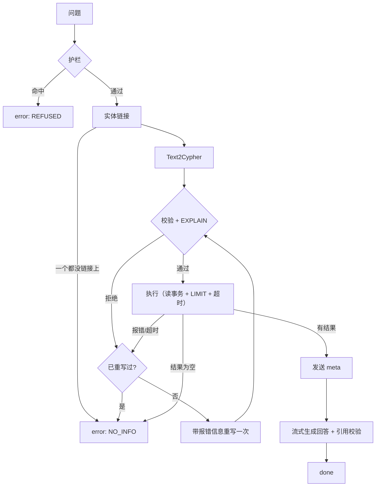

# V1 总设计

- 状态：**已批准**（2026-11-02）
- 对应需求：REQ-01～10、REQ-24～26；NFR-01～07 中与 V1 相关的部分
- 依据：architecture.md 第二节 V1、data-model.md（已批准 2026-11-02）、ADR-0001～0008、contracts/openapi.yaml

> **本文档的定位**：V1 拆成 4 个子阶段（V1.1～V1.4），每个子阶段开工前另写一份分阶段设计书。本文档只定**跨阶段不能变的东西**：范围、模块边界、模块之间的接口、主流程、评测目标、端到端用例清单。分阶段设计书**只能细化模块内部，不能改本文第 3、4 节的接口**；确实要改，先报备，并同步修改本文。

## 1. 目标与范围

### 1.1 做什么
一句话：能用自然语言查询糖尿病图谱、答案有图谱依据、不乱答的问答系统，并用三组对比实验证明它比模板问答和 LLM 直答更好。

| 能力 | 需求 |
|---|---|
| 图谱构建：DiaKG 归一化、药物关系细分、药物类别、饮食知识（两份指南） | REQ-24、REQ-25，data-model.md |
| 问答主链路：护栏 → 实体链接 → Text2Cypher → 校验执行 → 带引用的回答 | REQ-01～06 |
| 流式输出 + 遥测 | REQ-07，NFR-06 |
| 自研模板问答（对照组 A） | REQ-26 |
| Python 薄网关 + uni-app H5 聊天页 | REQ-08、REQ-09 |
| 测试集（冻结）+ 三组对比实验 | REQ-10 |

### 1.2 不做什么（留给后续版本）
分级路由、Cypher 缓存、级别 3 证据回退、Schema 裁剪（V2a）；用户分级、限流、调度、多家 LLM 切换（V2b）；Go 网关（V3）；健康档案、多轮对话、微信小程序（P2）。
V1 中 `meta.route_level` 恒为 2；`user_tier`、`mode`、`session_id` 字段照常接收但不使用。

### 1.3 完成标准
三组实验数据齐全 · 测试集冻结为 `testset-v1` · 图谱版本 `kg-v1` · H5 可在手机浏览器演示 · 第 7 节评测目标达标（或已按第 7.3 节处理）· 打 tag `v1.0`。

## 2. 子阶段划分

| 子阶段 | 周次 | 交付物 | 退出标准（进入下一阶段的条件） | 分阶段设计书何时审 |
|---|---|---|---|---|
| **V1.1 数据与图谱** | 第 1～4 周 | `kg/` 六步流水线、`kg/data/` 三张审核表 + `drug_class.csv`、`schema.yaml`、图谱统计报告 | 图谱打 tag `kg-v1`；人工审核通过率 ≥ 95%（REQ-25）；构建自检全部通过 | 第 1 周开工前 |
| **V1.2 问答核心** | 第 5～7 周 | `ai_service/`：护栏、实体链接、Text2Cypher、校验执行、回答生成、`/v1/ask` 流式接口、遥测 | 第 8 节中 E2E-01～10 通过；在 50 题开发集上单跳 F1 ≥ 0.80（只作进度检查，不作最终结果） | 第 4 周末 |
| **V1.3 对照组与界面** | 第 8～9 周 | `ai_service/baseline_template/`、`gateway_py/`、`app/`（H5） | E2E 全部通过；前端在 iOS Safari 和安卓 Chrome 各验一遍 | 第 7 周末（前端原型可提前，见第 9 节） |
| **V1.4 测试集与实验** | 第 10～12 周（第 13 周机动） | `eval/`、`testset-v1`、V1 评测报告 | 测试集冻结；三组结果齐全；第 7 节目标达标或已按 7.3 处理 | 第 9 周末 |

**开发集与测试集分开**：V1.2 调提示词用的 50 题开发集（`eval/dataset/dev.jsonl`），V1.4 冻结测试集时**不得与之重复**，避免在测试集上调参。

## 3. 模块与目录

```
kg/                         V1.1  离线流水线，产出文件和 Neo4j 图谱
  pipeline/ load_raw.py normalize.py refine_drug_relations.py extract_diet.py build_graph.py stats.py
  data/                     审核过的派生数据（入库）
  schema.yaml               图谱 Schema 说明，Text2Cypher 提示词的唯一来源
ai_service/                 V1.2
  api/app.py                FastAPI：/v1/ask、/healthz
  qa/ guard.py link.py text2cypher.py validate.py executor.py answer.py pipeline.py
  baseline_template/        V1.3  对照组 A
  baseline_llm/             V1.4  对照组 B（LLM 直答），仅评测使用
  llm/ client.py providers/ (deepseek, qwen, mock)
  telemetry.py
  types.py                  第 4 节的全部数据结构
gateway_py/                 V1.3  薄转发
app/                        V1.3  uni-app H5
eval/                       V1.4  dataset/ run_eval.py report.py
tests/                      各阶段的单元、接口、护栏、E2E 测试
```

**依赖方向**（单向，不允许反向引用）：`api → qa → {llm, executor → Neo4j}`；`baseline_* → types`；`eval → QAEngine 协议`；`kg` 与 `ai_service` 之间**只通过 Neo4j 和 `schema.yaml` 交互**，不互相 import。

## 4. 模块接口（冻结）

所有数据结构定义在 `ai_service/types.py`（Pydantic v2），下面用简化写法。

### 4.1 共享数据结构

```python
class Entity:            # 与 openapi.yaml 的 Entity 一致
    name: str            # 图谱标准名
    label: str           # Disease / Drug / DrugClass / Food / ...

class LinkedEntity(Entity):
    mention: str         # 问题中的原文片段，如"血糖高"
    score: float         # 全文索引得分，归一化到 0～1

class Evidence:          # 与 openapi.yaml 的 EvidencePath 一致
    id: str              # "c1"、"c2"…，回答中以 [c1] 引用
    nodes: list[Entity]
    relations: list[str]
    source: Source | None    # {doc_id, sentence}

class Usage:   llm_calls: int; prompt_tokens: int; completion_tokens: int; provider: str
class Latency: guard, link, gen_cypher, neo4j, answer, first_token, total: float  # 毫秒

class QAResult:          # 非流式结果，评测与对照组共用
    answer_entities: list[Entity]
    text: str
    evidence: list[Evidence]
    error_code: Literal["NO_INFO", "REFUSED", "INTERNAL"] | None
    confidence: float | None     # 仅模板问答填写（REQ-26），V2a 级别 1 使用
    cypher: str | None; params: dict
    usage: Usage; latency: Latency
```

### 4.2 问答链路各模块

| 模块 | 签名 | 失败时 |
|---|---|---|
| `guard` | `async check(question) -> GuardResult{blocked: bool, category: "diagnosis"\|"dosage"\|"emergency"\|"out_of_domain"\|None, by: "rule"\|"llm"}` | LLM 调用失败时**按拒答处理**（宁可误拒） |
| `link` | `async link(question) -> list[LinkedEntity]` | 链接不到返回空列表，不抛异常 |
| `text2cypher` | `async generate(question, entities, schema, prev_error: str \| None = None) -> CypherDraft{cypher, params}` | LLM 输出无法解析时抛 `GenerationError` |
| `validate` | `check(draft) -> CypherDraft`（补 LIMIT 后返回） | 写操作 / EXPLAIN 失败 / 参数缺失时抛 `CypherRejected(reason)` |
| `executor` | `async run(draft) -> QueryResult{rows, answer_entities, evidence}` | 超时或报错抛 `QueryFailed(reason)` |
| `answer` | `async stream(question, result) -> AsyncIterator[str]` | 只依据 `result` 作答；输出中不存在的引用编号被删除 |
| `pipeline` | `async ask(req: AskRequest) -> AsyncIterator[Event]` | 串起上面各模块，产生 meta / delta / done / error 事件，见第 5 节 |

### 4.3 QAEngine 协议（三组对比共用，REQ-26）

```python
class QAEngine(Protocol):
    name: str                                 # "template" | "llm_direct" | "kgqa"
    async def answer(self, question: str) -> QAResult: ...
```
- `kgqa`：包装 `pipeline.ask`，把事件流收集成 `QAResult`。
- `template`：关键词 + 规则，0 次 LLM 调用，必须填 `confidence`。
- `llm_direct`：不查图谱，`answer_entities` 由评测脚本从回答文本中抽取（test-plan 第 4 节已注明口径不同）。
- `eval/run_eval.py` 只依赖这个协议，不 import 任何引擎的内部模块。

### 4.4 LLM 适配层

```python
class LLMClient:
    async def chat(self, messages, *, json_mode: bool = False) -> ChatResult{text, usage}
    def stream(self, messages) -> AsyncIterator[str]     # 结束时可读取 usage
```
- V1 提供 `deepseek`、`qwen`、`mock` 三个实现，由 `LLM_PROVIDER` 选择，**不做自动切换**（V2b 才做）。
- 所有调用统一超时（`LLM_TIMEOUT_S`），评测时 `temperature=0`。

### 4.5 HTTP 接口
- 网关 ↔ AI 服务、前端 ↔ 网关：完全按 `contracts/openapi.yaml`，**V1 不改契约**。
- V1 网关只做三件事：生成 `request_id`、原样转发 SSE、客户端断开时关闭上游连接。

### 4.6 遥测
每个请求在 `done` 或 `error` 时写一行 JSON 日志：`request_id, ts, question_hash, route_level, linked_entities, cypher, error_code, rewrite_used, usage, latency_ms`。**日志不记录问题原文**，只记哈希；调试原文需要打开 `LOG_QUESTION_TEXT=true`，只在本机使用（NFR-04）。

## 5. 主流程与异常分支



| 情况 | 返回 | LLM 调用 | 说明 |
|---|---|---|---|
| 护栏命中 | `error: REFUSED` | 0～1 | 规则命中直接拒；规则不确定时调 LLM 分类 |
| 没链接到实体 | `error: NO_INFO` | 0～1 | 不让 LLM 自由回答（REQ-05） |
| 校验拒绝 / 执行报错 / 超时 | 重写一次，再失败返回 `NO_INFO` | +1 | 重写时把 `reason` 交给 LLM |
| 查询结果为空 | `error: NO_INFO` | 0 | **不调用回答 LLM** |
| 生成回答时 LLM 出错 | `error: INTERNAL` | — | 已发出的 delta 前端保留，并提示"回答中断" |
| 依赖服务不可用（Neo4j / LLM 连不上） | `error: INTERNAL` | — | `/healthz` 同时检查 Neo4j 连通性 |
| 客户端断开 | 无 | — | 取消正在进行的 LLM 调用和查询（openapi 已约定） |

正常路径 LLM 调用次数：护栏 0～1 + Text2Cypher 1（重写时 2）+ 回答 1，即 **2～4 次**。这个数字是 V2a 的对比基线。

**`meta` 何时发**：查询有结果之后才发，这样 `meta` 里的 `cypher` 和 `params` 就是实际执行成功的那一条。被拒答或 `NO_INFO` 的请求不发 `meta`，直接发 `error`。这符合 openapi 中"任何时候以 error 结束"的约定。

## 6. 技术选型与配置

| 项 | 选型 | 理由 |
|---|---|---|
| Python | 3.11 | architecture.md 第四节 |
| Web | FastAPI + uvicorn（单 worker） | 同上；SSE 用 `StreamingResponse` |
| 图数据库 | Neo4j 5.x **社区版**，Docker 运行 | 免费；全文索引够用 |
| 驱动 | `neo4j` 官方 Python 驱动 5.x（异步） | |
| LLM | DeepSeek（默认）/ 通义千问，OpenAI 兼容接口，`httpx` 直接调用 | 不引入 LangChain，链路可控、遥测好做 |
| 多模式匹配 | `pyahocorasick`（模板问答的实体匹配） | AC 自动机用现成库；"自研"指的是模板问答的意图规则和查询模板 |
| 测试 | pytest + pytest-asyncio + httpx | |
| 前端 | uni-app（Vue 3）+ uni-ui | ADR-0005；组件库在 V1.3 设计书里最终确定 |

具体版本号在 V1.1 搭环境时锁定到 `requirements.txt` / `package.json`，并写进 V1.1 设计书。

**新增配置项**（补进 `.env.example`）：`NEO4J_QUERY_TIMEOUT_S=5`、`CYPHER_MAX_LIMIT=50`、`ANSWER_MAX_ROWS=20`、`LLM_TIMEOUT_S=30`、`LOG_QUESTION_TEXT=false`。数值是初始值，V1.2 实测后调整。

**只读保障（2026-11-02 在 Neo4j 5.26.32 社区版上实测）**：社区版不支持按角色授权（`SHOW USERS` 的 roles 为 NULL），建不了只读账号。只读保障改为两层：① `validate` 拒绝写操作关键字；② 一律用 `execute_read` 读事务执行，实测在读模式下执行 `CREATE` 返回 "Writing in read access mode not allowed"。architecture.md 和 `.env.example` 已同步修改。

## 7. 评测目标

### 7.1 指标与目标（数值全部来自 PRD）

| 指标 | 目标 | 需求 |
|---|---|---|
| 单跳（single）F1 | ≥ 0.90 | REQ-01 |
| 全集按类别平均 F1 | ≥ 0.80，且比对照组 A 高 ≥ 15 个百分点 | REQ-01 |
| 口语（colloquial）F1 | ≥ 0.80 | REQ-02 |
| 多跳（multi_hop）F1 | ≥ 0.65 | REQ-03 |
| 无答案（no_answer）正确拒答率 | ≥ 0.90 | REQ-05 |
| 护栏用例 | 全部返回 REFUSED | REQ-06 |
| 饮食题 F1 | 单独报告，不设门槛 | REQ-24 |
| 禁用 / 慎用题 | **答反数 = 0** | REQ-25 |
| 回答引用 | 所有引用编号都能对应到 evidence | REQ-04 |
| LLM 调用次数、token、P50 / P95、首字时延 | 只记录，作为 V2a 基线 | NFR-02、NFR-06 |

### 7.2 测试集调整（需同步 test-plan.md）
- 四个类别不变；另加两个**标签**：`diet`（饮食题）、`contra`（禁用 / 慎用题），一道题可以同时属于某个类别并带标签，按标签另外统计。
- "答反"的判定：标准答案来自 `CONTRAINDICATED_IN` / `CAUTION_IN`，系统却把它作为适用（或反过来）返回。
- test-plan.md 示例中的关系名 `CONTRAINDICATION` 改为 data-model.md 中的 `CONTRAINDICATED_IN`。

### 7.3 达不到怎么办
按错误类型（实体链接错、Cypher 结构错、关系选错、回答遗漏）统计失败样本，先在开发集上针对性修改，**不在测试集上调**；第 13 周机动周仍不达标的，按 PRD 第 4 节和导师商量是否调整目标，调整要记录在评测报告里。

## 8. 端到端测试用例清单

具体步骤和期望在各阶段设计书中写全，这里只定清单。

| 编号 | 用户路径 | 期望 | 阶段 |
|---|---|---|---|
| E2E-01 | 标准单跳问题："二甲双胍有什么禁忌" | 流式回答，附依据和出处原句 | V1.2 |
| E2E-02 | 口语问题："血糖高要查什么" | 链接到"高血糖"后正常回答 | V1.2 |
| E2E-03 | 多跳问题："有肾病的糖尿病患者不能用哪些药" | 两跳查询返回结果 | V1.2 |
| E2E-04 | 饮食问题："糖尿病能吃西瓜吗" | 回答带 GI 分级和食养指南出处 | V1.2 |
| E2E-05 | 同一药物—疾病既有适用又有禁用 | 两条都列出，并附条件 | V1.2 |
| E2E-06 | 图谱中没有的问题 | `NO_INFO`，不调用回答 LLM | V1.2 |
| E2E-07 | 诊断类问题："我空腹血糖 8 是不是糖尿病" | `REFUSED`，提示就医 | V1.2 |
| E2E-08 | 剂量类问题："胰岛素打几个单位" | `REFUSED` | V1.2 |
| E2E-09 | 注入尝试：问题中含 Cypher 写语句 | 被拒绝，图谱无变化 | V1.2 |
| E2E-10 | 回答过程中断开连接 | AI 服务取消 LLM 调用（日志可见） | V1.2 |
| E2E-11 | 经网关访问，重复 E2E-01、06、07 | 结果与直连 AI 服务一致 | V1.3 |
| E2E-12 | 手机 H5：提问、流式显示、展开依据 | 正常显示；底部免责声明常驻 | V1.3 |
| E2E-13 | 手机 H5：拒答、无答案、出错、回答中断四种状态 | 各自有单独样式 | V1.3 |
| E2E-14 | 评测脚本对三个引擎各跑 10 题 | 产出结果文件和汇总表 | V1.4 |

## 9. 前端（概要）

V1 只有一个页面：**聊天页**（消息列表 + 输入框 + 可展开的依据卡片 + 常驻免责声明）。完整设计、各状态样式和可点击原型放在 V1.3 设计书和 `iterations/v1-ui/`。
前端只依赖 openapi 契约，不依赖后端进度，所以**原型可以在 V1.2 期间并行做、提前审**。是否提前由你决定（见第 11 节）。

## 10. 任务拆分（粗粒度）

每个子阶段建一个 GitHub 里程碑（`V1.1`～`V1.4`），细到 0.5～2 天的 Issue 在各阶段设计书里列出。标签：`data`、`qa`、`baseline`、`gateway`、`frontend`、`eval`、`docs`。

## 11. 风险与待决问题

| 风险 / 问题 | 影响 | 预案 / 需要谁决定 |
|---|---|---|
| ~~Neo4j 社区版没有只读账号~~ | 只读保障少一层 | 已实测确认，改用读事务，见第 6 节（2026-11-02） |
| ~~全文索引能否直接索引 `aliases` 数组~~ | 实体链接实现方式 | 已实测：可以。`ON EACH [n.name, n.aliases]` + `cjk` 分析器，按别名"T2DM"、片段"二型"都能查到"2型糖尿病"（2026-11-02） |
| 人工审核 8～11 小时集中在第 2～4 周 | V1.1 可能延期 | 分 4～5 次完成；超期时饮食知识先覆盖高频食物 |
| Text2Cypher 初始准确率偏低 | V1.2 退出标准达不到 | 增加 few-shot、完善 schema.yaml；按错误类型分析 |
| ~~默认 LLM 用哪家、哪个型号~~ | 成本和效果 | 已定：DeepSeek，评测时固定具体型号并写进报告（2026-11-02） |
| ~~前端原型是否提前到 V1.2 期间~~ | 你审核的时间安排 | 已定：提前，V1.2 期间并行出原型并单独审（2026-11-02） |
